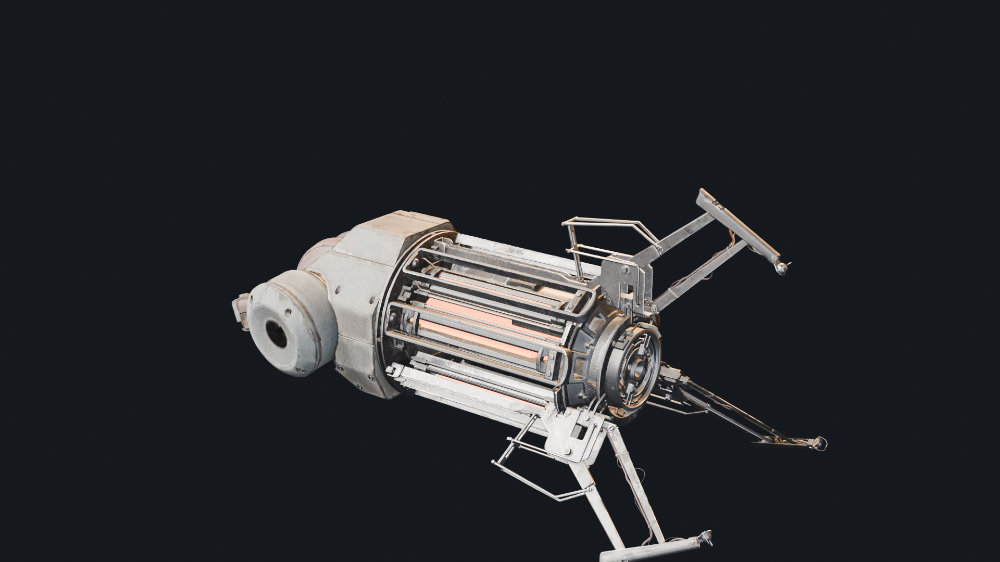

# Gravity Gun (Half-Life 2) for Cyberpunk 2077

Pick up crates, bodies and cars in Night City and throw them across the street — the Zero Point Energy Field
Manipulator from Half-Life 2, rebuilt on Half-Life 2's own rules (`weapon_physcannon.cpp`, Source SDK 2013).

**Download:** the ready-to-install archive is on Nexus Mods (link coming soon). This repository holds the source
code and configuration; the 3D model and sounds ship only in the archive.

> **Fan-made, non-commercial.** Not affiliated with or endorsed by Valve, CD PROJEKT RED, Orbifold Studios or
> NVIDIA. See [Disclaimer](#disclaimer) and [CREDITS](CREDITS.md).



## Features
- **Pull** (right mouse, hold): the object under the crosshair is pulled towards you and grabbed — props, NPCs
  (they go ragdoll) and vehicles.
- **Hold**: it floats in front of you and follows your aim.
- **Launch** (left mouse while holding) / **punt** (left mouse, empty-handed): Half-Life 2's launch speeds and punt
  impulses, scaled by mass.
- Half-Life 2 RTX gravity gun model with PBR textures, its sounds, glow, inventory icon, name and description
  (English, Russian).
- The gun is added to your inventory a few seconds after loading a save (or via the CET hotkey).
- Tuning window in the Cyber Engine Tweaks overlay (view position, force).

## Requirements
Tested with **Cyberpunk 2077 2.31** and these versions (newer ones should work):

| Mod | Tested version | Link |
|---|---|---|
| Cyber Engine Tweaks | 1.37.1 | https://www.nexusmods.com/cyberpunk2077/mods/107 |
| RED4ext | 1.30.0 | https://www.nexusmods.com/cyberpunk2077/mods/2380 |
| redscript | (installed with the game's mod setup) | https://www.nexusmods.com/cyberpunk2077/mods/1511 |
| ArchiveXL | 1.27.4 | https://www.nexusmods.com/cyberpunk2077/mods/4198 |
| TweakXL | 1.11.5 | https://www.nexusmods.com/cyberpunk2077/mods/4197 |
| Codeware | 1.20.5 | https://www.nexusmods.com/cyberpunk2077/mods/7780 |
| Audioware (sounds) | 1.9.9 | https://github.com/cyb3rpsych0s1s/audioware/releases |

Single-player only.

## Install
Vortex / MO2: install the archive as usual. Manual: extract it into the game folder
(the one with `bin`, `archive`, `r6`) so that you get:
```
archive/pc/mod/gravgun.archive
archive/pc/mod/gravgun.archive.xl
bin/x64/plugins/cyber_engine_tweaks/mods/gravgun/init.lua
r6/audioware/gravgun/*.wav, audios.yml
r6/tweaks/gravgun.yaml
```

## Controls
| Action | Default |
|---|---|
| Pull / cancel / drop | right mouse button (with the gravity gun in hands) |
| Launch / punt | left mouse button |
| Same with any weapon | CET overlay → Bindings → `gravgun_grab`, `gravgun_punt` |
| Give the gun | CET overlay → Bindings → `gravgun_give` |

## Uninstall
Delete the five paths above. The gun disappears from the inventory on the next load.

## Known issues
- **Crashes with Audioware 1.9.9-rc**: on the author's PC most crash dumps had `audioware.dll` on the crashing thread.
  If the game crashes, remove Audioware (`red4ext/plugins/audioware`, `r6/scripts/Audioware`) — the gun works
  silently without it.
- Static world props (parts of the level) cannot be moved — only physical objects, NPCs and vehicles.
- Log: `bin/x64/plugins/cyber_engine_tweaks/mods/gravgun/log.txt` (attach it to bug reports).

## Disclaimer
This is a free fan project made for fun. It is not affiliated with, endorsed or sponsored by Valve Corporation,
CD PROJEKT S.A., Orbifold Studios or NVIDIA. *Half-Life*, the gravity gun and its sounds are trademarks and
copyrighted works of Valve Corporation; *Cyberpunk 2077* belongs to CD PROJEKT S.A. The 3D model is used under its
Creative Commons license (see [CREDITS](CREDITS.md)). No money, donations or premium access are tied to this mod.
**Rights holders:** if you want any content removed, open an issue at https://github.com/perseval-BLR/Cyberpunk2077-Gravity-Gun or message perseval-BLR — it will be taken down
promptly.

## How it was made
Built by perseval-BLR together with Claude Code (Anthropic, model Claude Opus 5.5): reverse engineering of the game's
scripting API, the physics port from Half-Life 2's source, the model conversion (Blender, WolvenKit) and the item
files. Code: MIT (see [LICENSE](LICENSE)); third-party assets keep their own terms.

---

# Гравипушка (Half-Life 2) для Cyberpunk 2077

Поднимайте ящики, тела и машины в Найт-Сити и швыряйте их через улицу — гравипушка из Half-Life 2 с поведением по
исходникам HL2 (`weapon_physcannon.cpp`).

- **ПКМ (удерживать)** — притянуть и схватить предмет, человека (рэгдолл) или машину; ещё раз — отпустить.
- **ЛКМ** — бросить удерживаемое или оттолкнуть то, что под прицелом.
- Пушка появляется в инвентаре через несколько секунд после загрузки сохранения (или по горячей клавише CET).

**Требования:** Cyberpunk 2077 2.31, Cyber Engine Tweaks, RED4ext, redscript, ArchiveXL, TweakXL, Codeware,
Audioware (звук) — ссылки в таблице выше. **Установка:** распаковать архив в папку игры. **Удаление:** удалить
пять путей из списка выше.

**Известная проблема:** у автора вылеты игры совпадали с Audioware 1.9.9-rc. Если игра вылетает — удалите Audioware,
пушка будет работать без звука.

**Дисклеймер:** бесплатный фанатский мод, не связан с Valve, CD PROJEKT RED, Orbifold Studios и NVIDIA. Half-Life,
гравипушка и её звуки принадлежат Valve. Модель — по лицензии CC BY 4.0 (см. CREDITS). Правообладатели могут
запросить удаление — контент будет удалён.
